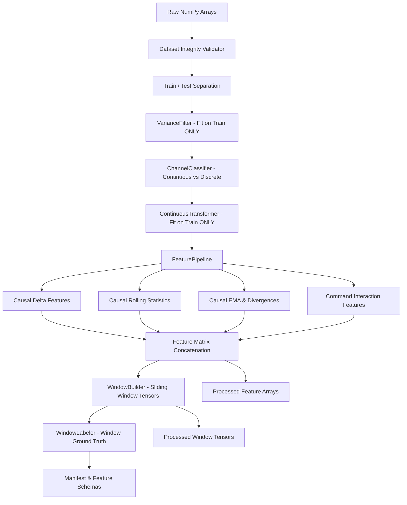

# ML Preprocessing & Temporal Feature Engineering Architecture

> **SpaceGuard AI — ML Phase 3A Research Specification**  
> **Status:** Research Implementation Complete  
> **Scope:** Research Preprocessing, Feature Engineering, and Windowing Only.  
> **Rule:** **NO MACHINE LEARNING MODELS WERE TRAINED IN THIS PHASE.**

---

## 1. Objective

The objective of ML Phase 3A is to transform the raw NASA SMAP/MSL Telemanom benchmark (`ml-service/data/raw/nasa_smap_msl/`) into deterministic, reproducible, leakage-safe, model-ready research datasets.

Spacecraft telemetry presents unique physical characteristics that violate ordinary i.i.d. tabular assumptions:
- **Channel Asymmetry:** Channel 0 is the primary continuous telemetry reading; auxiliary channels are predominantly discrete or binary command indicators.
- **Zero-Variance Modes:** Nominal cruise periods leave emergency or safemode command channels completely idle (`std = 0.0`).
- **Temporal Persistence:** Ground-truth spacecraft faults manifest as sustained multi-step operational episodes (median duration ~121–131 steps), not isolated point spikes.
- **Causality Constraints:** Features computed at time $t$ must never consume future information ($t' > t$).
- **Strict Data Isolation:** Preprocessing parameters (variances, centers, scales) must be derived solely from training splits.

---

## 2. Dataset Inputs & Immutability

The pipeline ingests raw arrays from `ml-service/data/raw/nasa_smap_msl/`:
- `MSL_train.npy` `(58317, 55)`, `MSL_test.npy` `(73729, 55)`, `MSL_test_label.npy` `(73729,)`
- `SMAP_train.npy` `(135183, 25)`, `SMAP_test.npy` `(427617, 25)`, `SMAP_test_label.npy` `(427617,)`

**Immutability Guarantee:**
Raw arrays are loaded with immutable memory flags (`data.flags.writeable = False`). All transformations occur in dedicated research modules and output to `ml-service/data/processed/` and `ml-service/artifacts/`. Raw files remain byte-identical.

---

## 3. Preprocessing Pipeline Architecture

The pipeline executes sequentially in a strict unidirectional flow:



---

## 4. Variance Filtering (Training-Derived)

### Logic
Standard scaling (z-score normalization) or covariance estimation fails with division-by-zero errors when encountering constant channels.
- Filter criteria: $\mathrm{Var}(X_{\text{train}, c}) < 10^{-8}$.
- **Fit Split:** Training split only. If a channel is constant in nominal training, it is masked out. Test data variance is never inspected for filtering decisions.
- **Results:**
  - **MSL:** 22 channels removed (indices: `[7, 9, 12, 13, 14, 15, 17, 18, 19, 21, 22, 23, 25, 27, 28, 29, 30, 31, 32, 33, 34, 35]`). 33 channels retained.
  - **SMAP:** 1 channel removed (index: `[16]`). 24 channels retained.

---

## 5. Channel Classification

Channels are classified deterministically without assigning fabricated physical subsystem names:
1. **Continuous Channel:** Index 0 is established as the primary continuous telemetry channel.
2. **Discrete / Command Channels:** Retained auxiliary channels whose values are restricted to binary ($\{0, 1\}$ or $\{-1, 1\}$) or low-cardinality discrete sets ($\le 5$ integer levels).
3. **Mixed Channels:** Any channel exhibiting non-binary float values with intermediate cardinality. None were observed in the retained benchmark channels.

---

## 6. Continuous Scaling Strategies

The EDA confirmed that Channel 0 is already bounded approximately in $[-1.0, 1.0]$ and exhibits multimodal non-Gaussian plateaus.
To avoid premature assumptions, the scaler is configurable:
- **`passthrough`:** Preserves raw pre-scaled NASA values.
- **`robust` (Default Candidate):** Uses median and interquartile range (IQR):
  $$x_{\text{scaled}} = \frac{x - \mathrm{median}(X_{\text{train}})}{\mathrm{IQR}(X_{\text{train}})}$$
  Robust to outliers and telemetry spikes.
- **`minmax`:** Rescales strictly to $[-1.0, 1.0]$ using training minimum and maximum.
- **Rule:** Fitted exclusively on `X_train[:, 0]`. Test split continuous values are transformed using training parameters. Scalers are serialized via `joblib` alongside JSON parameter records.

---

## 7. Temporal Feature Engineering Families

All engineered features are computed causally: at observation index $t$, features depend exclusively on samples $\le t$.

### 7.1. Temporal Delta Features
Captures abrupt sensor transients and discrete command toggles:
$$\Delta_1(t) = x_0(t) - x_0(t-1)$$
Boundary condition: $\Delta_1(0) = 0.0$.

### 7.2. Rolling Statistics
Calculated over causal sliding history windows $W \in [10, 30, 100]$:
- **Rolling Mean:** $\mu_W(t) = \frac{1}{W} \sum_{k=0}^{W-1} x_0(t-k)$
- **Rolling Std:** $\sigma_W(t) = \sqrt{\frac{1}{W-1} \sum_{k=0}^{W-1} (x_0(t-k) - \mu_W(t))^2}$
- **Rolling Min:** $\min_{k \in [0, W-1]} x_0(t-k)$
- **Rolling Max:** $\max_{k \in [0, W-1]} x_0(t-k)$
- Total: 12 rolling features (3 window sizes $\times$ 4 metrics).

### 7.3. Exponential Moving Averages (EMA) & Divergences
Calculated recursively with smoothing factor $\alpha = \frac{2}{\text{span} + 1}$:
$$y_t = (1 - \alpha) y_{t-1} + \alpha x_t$$
- Spans: 10, 30, 100.
- Divergences:
  $$\mathrm{div}_{10, 30}(t) = \mathrm{EMA}_{10}(t) - \mathrm{EMA}_{30}(t)$$
  $$\mathrm{div}_{30, 100}(t) = \mathrm{EMA}_{30}(t) - \mathrm{EMA}_{100}(t)$$
- Total: 5 EMA features.

### 7.4. Command Interaction Features
Spacecraft commands alter physical subsystem state. To avoid an $O(N^2)$ feature explosion, 3 bounded operational context features are computed:
1. `active_command_count`: $\sum_{c \in \text{commands}} \mathbb{I}(x_c(t) \neq 0)$
2. `continuous_val_when_command_active`: $x_0(t) \cdot \mathbb{I}(\text{active\_commands} > 0)$
3. `continuous_delta_when_command_active`: $\Delta_1(t) \cdot \mathbb{I}(\text{active\_commands} > 0)$

---

## 8. Final Feature Dimensionality

| Mission | Raw Channels | Retained Channels | Continuous Scaled | Deltas | Rolling Stats | EMA & Divs | Command Context | Retained Discrete | Total Features |
|---|---|---|---|---|---|---|---|---|---|
| **MSL** | 55 | 33 | 1 | 1 | 12 | 5 | 3 | 32 | **54** |
| **SMAP** | 25 | 24 | 1 | 1 | 12 | 5 | 3 | 23 | **45** |

All features are converted to `float32` for memory efficiency.

---

## 9. Sliding Window Construction & Labeling

### Windowing Strategy
Sliding windows are constructed using vectorized NumPy strided views:
- Candidate window lengths: $W \in [50, 100, 128, 256]$.
- Candidate strides: $S \in [1, 5, 10]$.
- Default baseline tensor: $W = 128, S = 10$.
- Memory safety: Tensors are checked against an allocation threshold before materialization.

### Labeling Strategies
For test splits where ground truth exists:
1. **`any_anomaly`:** $\exists t \in [w_{\text{start}}, w_{\text{end}}): y(t) = \text{True}$.
2. **`majority_anomaly`:** $\frac{1}{W} \sum_{t=w_{\text{start}}}^{w_{\text{end}}-1} y(t) \ge \tau$ (default threshold $\tau = 0.5$).
3. **`anomaly_fraction`:** Continuous ratio of anomalous points in window.

Vectorized prefix sums (`np.cumsum`) calculate window labels in $O(1)$ time per window without looping.

---

## 10. Data Leakage Prevention Guarantees

The pipeline enforces 5 architectural safeguards verified by automated tests in `tests/test_leakage.py`:
1. **No Test Parameter Leakage:** Scalers and variance masks are fit solely on training data.
2. **Strict Causality:** Rolling, delta, and EMA features depend strictly on indices $\le t$. Perturbing future observations ($t > t_0$) causes zero change in past features.
3. **Split Boundary Integrity:** Windows are generated strictly within individual splits. No window bridges train and test observations.
4. **Finite Values:** All output arrays are validated to contain 0 NaNs and 0 Infs.
5. **Raw Data Immutability:** Raw benchmark files are validated by byte size and checksums.

---

## 11. Artifact Hierarchy

```
ml-service/
├── data/
│   ├── raw/
│   │   └── nasa_smap_msl/                  <-- IMMUTABLE RAW BENCHMARK
│   └── processed/
│       ├── PROCESSING_MANIFEST.json        <-- Manifest with all parameters
│       ├── MSL/
│       │   ├── preprocessing/              <-- variance_filter.json, continuous_scaler.joblib
│       │   ├── features/                   <-- MSL_train_features.npy, MSL_test_features.npy
│       │   └── windows/                    <-- Default window tensors & labels (w128_s10)
│       └── SMAP/
│           ├── preprocessing/
│           ├── features/
│           └── windows/
├── artifacts/
│   └── features/
│       ├── MSL/feature_schema.json         <-- Programmatic feature dictionary
│       └── SMAP/feature_schema.json
└── config/
    └── preprocessing.yaml                  <-- Declarative experiment configuration
```

---

## 12. Known Limitations & Research Open Questions

1. **Anonymous Physical Semantics:** Channels remain numerical indices without physical engineering units.
2. **No Physical UTC Timestamps:** Temporal axis is sample index $t \in [0, N-1]$.
3. **Hyperparameter Selection Deferred:** Optimal window size ($W$), stride ($S$), and continuous scaler (`passthrough` vs `robust` vs `minmax`) are experimental candidates that must be systematically evaluated in Phase 3B/4 model benchmarking.
4. **ML Training Status:** **NO ML MODEL HAS BEEN TRAINED.**
